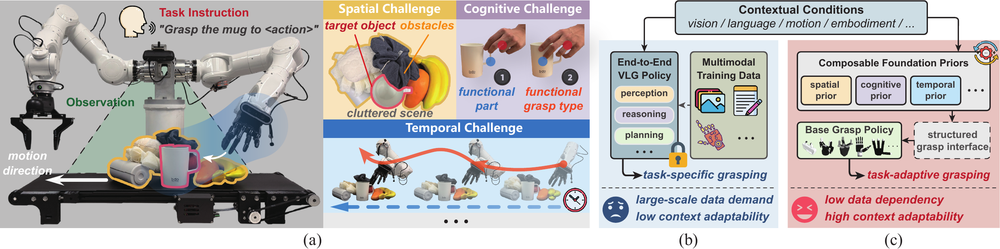

# AdaRoboVLG: Adaptive Vision-Language Grasping via Composable Foundation Priors and Generalizable Grasp Synthesis


[](https://adarobovlg.github.io/)

This is the official repository for AdaRoboVLG, an adaptive vision-language grasping framework for generalizable grasp synthesis across different robotic hands. This repository open-sources only its language-guided target grasping capability for static and dynamic scenes, supporting parallel-jaw grippers and Allegro, Inspire, and DH3 multi-finger hands. It outputs SE(3) poses and gripper widths for parallel-jaw grippers, and hand-base poses, grasp types, and joint configurations for multi-finger hands.



> AdaRoboVLG is an task-adaptive vision-language grasping framework that enables robots to perform context-aware grasp synthesis under diverse task conditions and hand embodiments.

## 📚 Contents

- [Pipeline Overview](#pipeline-overview)
- [Environment Installation](#environment-installation)
- [Model Weights](#model-weights)
- [Service Usage](#service-usage)
- [AdaRoboVLG-Playground](#adarobovlg-playground-evaluation)
- [Directory Structure](#directory-structure)
- [Third-Party Sub-Libraries](#third-party-sub-libraries)
- [Additional Documentation](#additional-documentation)
- [Acknowledgements](#acknowledgements)
- [License](#license)

<a id="pipeline-overview"></a>
## 🧩 Pipeline Overview

### Language-guided Target Grasping in Static Scenes

```text
Language description + multi-view RGB-D
        │
        ▼  VLM target localization + SAM3 segmentation
        ▼  3D mask projection
        ▼  ContactGraspNet CGRs generation
        ▼  Grasp adaptation
           (parallel jaw: center and width adjustment;
            multi-finger hand: hand mapping, collision filtering, and scoring)
        ▼  Pose conversion + workspace filtering
        ▼
   Grasp candidates
```

### Language-guided Target Grasping in Dynamic Scenes

```text
Language description + initial multi-view RGB-D
        │
        ▼  Static grasp candidate generation
        ▼  Manual grasp selection
        ▼  DINOv2/XMem tracker initialization
        ▼  Subsequent multi-view RGB-D observations
        ▼  Rigid target transformation estimation
        ▼  Selected grasp pose update
        ▼
   Updated grasp
```

<a id="environment-installation"></a>
## 🛠️ Environment Installation

Clone the repository and enter its root directory:

```bash
cd <your-ws-path>
git clone https://github.com/AdaRoboVLG/AdaRoboVLG.git
cd AdaRoboVLG
```

We recommend creating a conda environment with **Python 3.10** (the version used by this project):

```bash
conda create -n AdaRoboVLG python=3.10
conda activate AdaRoboVLG
```

### 1. Install PyTorch

Set the CUDA 11.8 toolkit path before installing packages that build CUDA extensions, then
install the matching PyTorch wheels:

```bash
export CUDA_HOME=/usr/local/cuda-11.8
export PATH="$CUDA_HOME/bin:$PATH"

pip install torch==2.4.1 torchvision==0.19.1 --index-url https://download.pytorch.org/whl/cu118
```

If you use a different CUDA version, visit [PyTorch website](https://pytorch.org/get-started/locally/) to get the appropriate install command.

### 2. Install core dependencies

```bash
pip install -r requirements.txt
```

`requirements.txt` includes all necessary packages except PyTorch (which was installed above) and pytorch3d (which requires special installation, see below).

### 3. Install PyTorch3D

PyTorch3D requires special installation from source:

```bash
pip install fvcore iopath
pip install --no-build-isolation \
  "git+https://github.com/facebookresearch/pytorch3d.git@0a7d4c1a171e8b768c63f15b17564f9ad495f49b"
```

### 4. Install PyTorch Geometric dependencies

Install torch-scatter for multi-finger grasp scoring:

```bash
pip install torch-scatter -f https://data.pyg.org/whl/torch-2.4.0+cu118.html
```

### 5. Install additional dependencies

```bash
pip install spconv-cu118==2.3.8
pip install flash-attn==2.6.3 --no-build-isolation
```

### 6. Install third-party sub-libraries

The repository contains five external components under `./third_party`. Install all of them
in editable mode so every service resolves the bundled, locally adapted implementation:

```bash
pip install --no-deps \
  -e third_party/contact_graspnet \
  -e third_party/d3fields \
  -e third_party/dinov2 \
  -e third_party/graspnetAPI \
  -e third_party/urchin
```

`--no-deps` keeps dependency resolution centralized in `requirements.txt` instead of
reapplying the vendored packages' older dependency pins. XMem is part of D3Fields and does
not require a separate installation.

<a id="model-weights"></a>
## 💾 Model Weights

Model weights are **not distributed with the repository**. Download the complete weight package and extract it to `checkpoints/` in the project root.

**Download all model weights:** [Hugging Face](https://huggingface.co/adarobovlg/adarobovlg/tree/main)

The extracted directory should have the following layout:

```text
checkpoints/
├── manifest.json
├── sam3/                         # Complete Transformers model directory
├── contact_graspnet/gc6d.pth
├── hand_decision/hand_decision_model_8145.pth
├── dinov2/dinov2_vitl14_pretrain.pth
└── xmem/
    ├── XMem.pth
    ├── resnet18-5c106cde.pth
    └── resnet50-19c8e357.pth
```

By default, weights are resolved relative to the project root. Set `ADAROBOVLG_CHECKPOINTS_DIR` to use another weight directory, or override individual paths with `ADAROBOVLG_SAM3_PATH`, `ADAROBOVLG_GRASP_CHECKPOINT`, and `ADAROBOVLG_HAND_CHECKPOINT`. See the [model weights guide](docs/model_weights.md) for each weight's purpose, loading location, file size, and SHA256 checksum.

<a id="service-usage"></a>
## 🔌 Service Usage

### VLM Configuration

By default, target localization uses a Qwen vision-language model through an OpenAI-compatible API. Configure the service before starting a server:

```bash
export DASHSCOPE_API_KEY='YOUR_API_KEY'
export ADAROBOVLG_VLM_MODEL='qwen3.5-plus'
export ADAROBOVLG_VLM_BASE_URL='https://dashscope.aliyuncs.com/compatible-mode/v1'
```

Another VLM can use these environment variables directly only if it provides an OpenAI-compatible Chat Completions endpoint, accepts Base64 `image_url` input together with the current `response_format` and `enable_thinking` parameters, and returns exactly one `[xmin, ymin, xmax, ymax]` bounding box per image as a strict JSON array with coordinates in the `0–1000` range. Otherwise, adapt the request and response handling in `ObjectDetector` in [model/mask_generator.py](model/mask_generator.py). The current implementation reads the provider key from `DASHSCOPE_API_KEY`. The `--text-prompt` option selects the local English-prompt path and does not call a VLM.

### Language-Guided Target Grasping Services

The four general deployment services are:

| Scene | End effector | Server | Port |
| --- | --- | --- | ---: |
| Static | Parallel-jaw gripper | `server/static_grasp/server_gripper.py` | 5555 |
| Static | Multi-finger dexterous hand | `server/static_grasp/server_dexhand.py` | 5556 |
| Dynamic | Parallel-jaw gripper | `server/dynamic_grasp/server_gripper.py` | 5557 |
| Dynamic | Multi-finger dexterous hand | `server/dynamic_grasp/server_dexhand.py` | 5558 |

The server is the component users deploy to provide grasp inference. The scripts under [client/](client/) are only reference clients: they replay offline observations and demonstrate how to construct requests and receive results. They are not required when a simulator or robot already implements the protocol described in [docs/protocol.md](docs/protocol.md).

The following examples use the offline observations described in [data/examples/README.md](data/examples/README.md). Obtain these files before running the commands. Use two terminals from the repository root and run `conda activate AdaRoboVLG` in both. Start the server in Terminal 1 and leave it running, then invoke the example client from Terminal 2. These examples use VLM localization; do not add `--text-prompt`. Workspace bounds are specific to the recorded scenes.

#### 1. Parallel-Jaw Gripper (Static Scenes)

```bash
# Terminal 1: start the server
python server/static_grasp/server_gripper.py --no-visualizer \
  --workspace-bounds 0.20 0.90 -0.40 0.40 -0.20 0.40
```

```bash
# Terminal 2: run the example client
python client/static_grasp/client_gripper.py \
  --data data/examples/static/red_chips_can.pkl \
  --prompt 'red chips can' --obs-pose world-to-camera
```

#### 2. Multi-Finger Dexterous Hand (Static Scenes)

```bash
# Terminal 1: start the server
python server/static_grasp/server_dexhand.py --hand AllegroHand --no-visualizer \
  --workspace-bounds 0.20 0.90 -0.40 0.40 -0.20 0.40
```

```bash
# Terminal 2: run the example client
python client/static_grasp/client_dexhand.py \
  --data data/examples/static/red_chips_can.pkl \
  --hand AllegroHand --prompt 'red chips can' --obs-pose world-to-camera
```

#### 3. Parallel-Jaw Gripper (Dynamic Scenes)

```bash
# Terminal 1: start the server
python server/dynamic_grasp/server_gripper.py --no-visualizer \
  --workspace-bounds 0.05 0.65 0.05 0.58 -0.40 -0.20
```

```bash
# Terminal 2: run the example client
python client/dynamic_grasp/client_gripper.py \
  --data data/examples/dynamic/white_box_000.pkl \
  --next-data data/examples/dynamic/white_box_001.pkl \
  --prompt 'white box' --obs-pose world-to-camera
```

#### 4. Multi-Finger Dexterous Hand (Dynamic Scenes)

```bash
# Terminal 1: start the server
python server/dynamic_grasp/server_dexhand.py --hand AllegroHand --no-visualizer \
  --workspace-bounds 0.00 0.80 -0.10 0.70 -0.60 0.10
```

```bash
# Terminal 2: run the example client
python client/dynamic_grasp/client_dexhand.py \
  --data data/examples/dynamic/white_box_000.pkl \
  --next-data data/examples/dynamic/white_box_001.pkl \
  --hand AllegroHand --prompt 'white box' --obs-pose world-to-camera
```

The provided multi-finger dexterous-hand models and inference services support right-hand configurations only. To use another supported right hand, replace `AllegroHand` in both commands with `InspireHand` or `DH3Hand`. Although some left-hand URDF and mesh assets are included for Allegro and Inspire, the repository does not provide left-hand grasp mapping, collision models, or an integrated left-hand inference pipeline.

#### 5. Interaction and Protocol

Remove `--no-visualizer` to enable candidate previews. Static visualization and every dynamic initialization require confirmation in the server terminal; later dynamic frames update the selected grasp automatically. The services exchange trusted pickled dictionaries over ZMQ and return grasp poses rather than executing them. See the [protocol guide](docs/protocol.md) for selection commands, request and reply schemas, coordinates, units, and custom-client integration.

If target segmentation remains empty after the grasp-point retry, static services may return grasps generated from the full workspace rather than the requested target, while dynamic services cannot initialize tracking without target points. If no usable grasp pose remains after generation, hand mapping, or workspace filtering, the server returns an error reply instead of empty pose arrays. A successful reply therefore confirms inference completion, not target recognition; see the [protocol guide](docs/protocol.md#target-detection-and-full-scene-fallback) for the exact behavior.

<a id="adarobovlg-playground-evaluation"></a>
## 🧪 AdaRoboVLG-Playground

[AdaRoboVLG-Playground](https://github.com/AdaRoboVLG/AdaRoboVLG-Playground) is based on LIBERO and tests language-guided target grasping with a parallel-jaw gripper in static scenes. It provides the grasp-only LIBERO Long, Goal, and Object evaluations used for model comparison, together with a randomized Objaverse-object playground. The model server and simulator client run in separate environments and communicate over ZMQ:

```text
AdaRoboVLG-Playground (LIBERO-based client and simulated Franka)
        │  observations, point cloud, and language target
        ▼  ZMQ (port 6666)
server/libero/server_gripper.py (AdaRoboVLG model server)
        │  absolute end-effector action chunk
        ▼
   Franka robot in LIBERO
```

Start the model server from this repository:

```bash
# Terminal 1: AdaRoboVLG model environment
python server/libero/server_gripper.py
```

Verify the server from the adjacent `AdaRoboVLG-Playground` repository:

```bash
# Terminal 2: LIBERO/robosuite/cuRobo environment
python validate_server.py --host 127.0.0.1 --port 6666
```

Run 50 trials per task in the `AdaRoboVLG-Playground` repository:

```bash
python evaluate_libero_tasks.py name=libero_tasks trial_num=50

# Or run five simulator processes in parallel.
python parallel_eval.py \
  exp_name=parallel_eval_libero_tasks parallel_env_num=5 trial_num=50
```

Aggregate a single-process run:

```bash
python misc/get_statistics.py name=libero_tasks
```

The default LIBERO configuration evaluates adapted target-grasp tasks from `libero_object`, `libero_10`, and `libero_goal`. See the [Playground evaluation guide](docs/libero.md) for simulator installation, LIBERO and Objaverse commands, task adaptation, packet fields, action chunks, and result accounting.

<a id="directory-structure"></a>
## 📁 Directory Structure

```text
model/          Core model and inference pipeline
server/         Static, dynamic, and LIBERO ZMQ services
client/         Reference clients for offline observation replay
dexgraspapi/    Dexterous grasp representations, mapping, and collision filtering
robots/hands/   Multi-finger hand models and geometry
utils/          Geometry, transforms, paths, and I/O helpers
test/           Service, geometry, and inference checks
data/           Hand assets and recorded observation examples
checkpoints/    Model weights and checksum manifest
docs/           Protocol, testing, and integration documentation
third_party/    Bundled external implementations
```

See the [repository structure guide](docs/repository_structure.md) for important files and expanded subdirectories.

<a id="third-party-sub-libraries"></a>
## 📦 Third-Party Sub-Libraries

Use the bundled implementations because this project depends on local adaptations. See the [third-party component guide](docs/third_party.md) for sources, roles, setup methods, and licensing notes; installation commands remain under [Environment Installation](#environment-installation).

<a id="additional-documentation"></a>
## 📖 Additional Documentation

| Guide | Contents |
| --- | --- |
| [Protocol](docs/protocol.md) | Request/reply schemas, coordinates, units, and tracking sessions |
| [Troubleshooting](docs/troubleshooting.md) | Common errors and recovery steps |
| [Testing](docs/testing.md) | Regression checks and optional real-inference validation |
| [AdaRoboVLG-Playground](docs/libero.md) | LIBERO and Objaverse static parallel-jaw evaluations, protocol, and action trajectory |
| [Model Weights](docs/model_weights.md) | Weight purposes, loading locations, and checksum verification |
| [Repository Structure](docs/repository_structure.md) | Expanded source layout and important entry points |
| [Third-Party Components](docs/third_party.md) | Bundled dependency provenance, setup, and licenses |

Regression checks under `test/` validate interfaces and processing logic; see the [testing guide](docs/testing.md) for commands and requirements. They are not evaluations of the paper's grasping performance.

The supported general grasp entrypoints are the four services documented above; the LIBERO server is a simulator-specific adapter. Legacy all-scene inference, model-level grasp tracking, image classification, and multi-box segmentation APIs have been removed.


<a id="acknowledgements"></a>
## 🤝 Acknowledgements

This project builds upon the following open-source projects: [AnyDexGrasp](https://github.com/graspnet/AnyDexGrasp), [GraspNet-1Billion](https://github.com/graspnet/graspnetAPI), [GraspClutter6D](https://github.com/SeungBack/graspclutter6dAPI), [GC6D Contact-GraspNet](https://github.com/SeungBack/gc6d-contact-graspnet), [Point Transformer V3](https://github.com/Pointcept/PointTransformerV3), [SAM 3](https://github.com/facebookresearch/sam3), [DINOv2](https://github.com/facebookresearch/dinov2), [XMem](https://github.com/hkchengrex/XMem), and [D3Fields](https://github.com/WangYixuan12/d3fields).

<a id="license"></a>
## 📄 License

The code developed for this project is released under the [MIT License](LICENSE). Third-party components are subject to their respective licenses. Model weights and datasets may have separate terms of use; please review the conditions provided by their original authors before use or redistribution.
